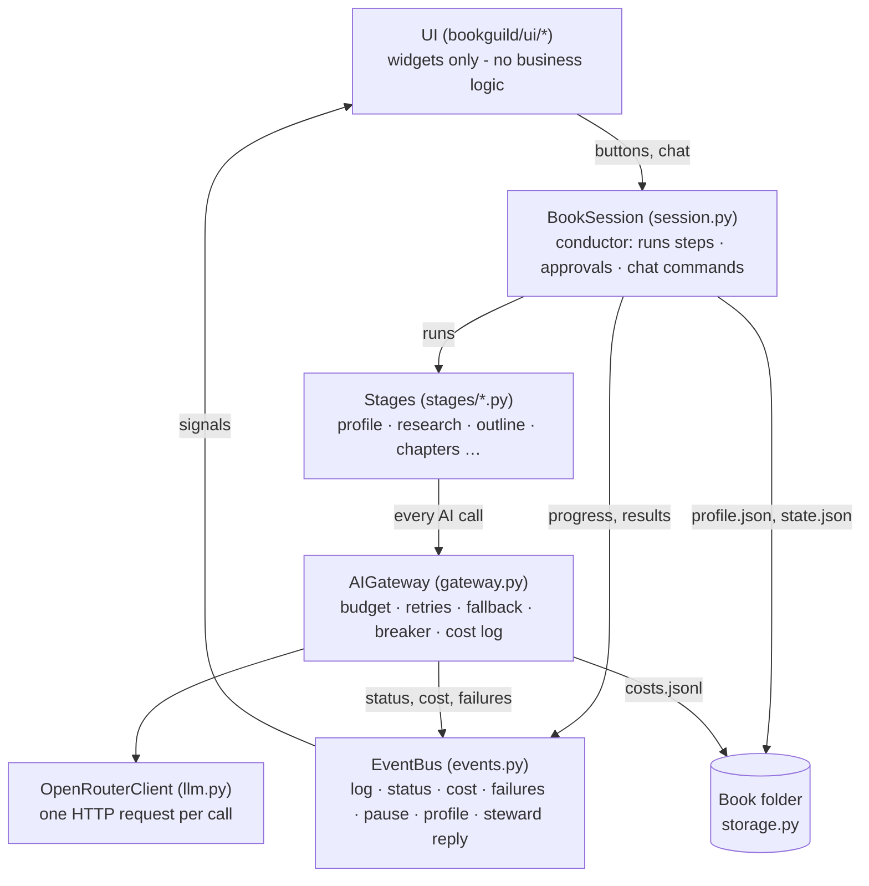
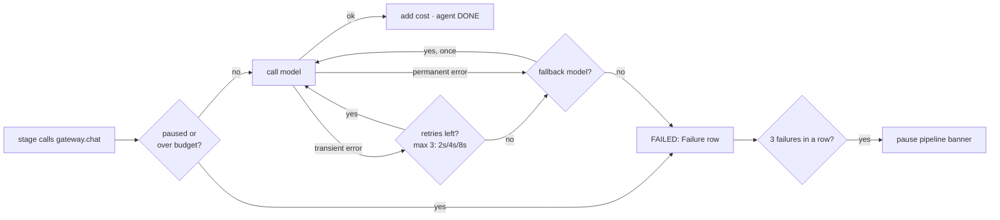
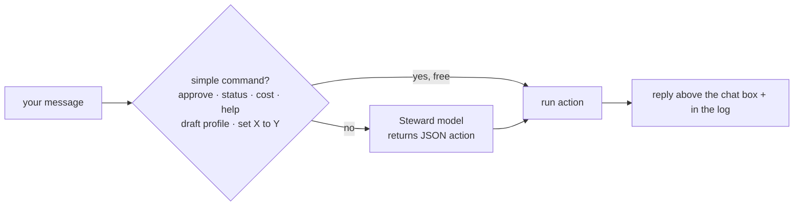
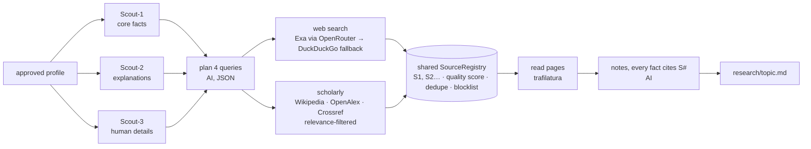
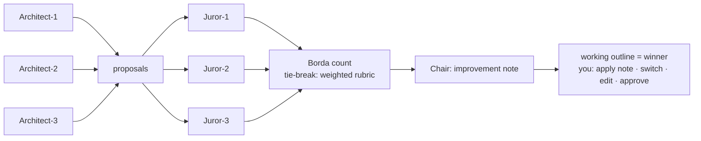
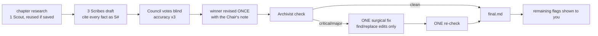
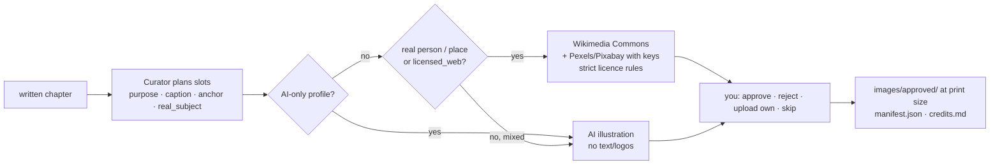

# Book Guild: architecture

This document explains how the app fits together, so work can be resumed later. **It is updated at the end of every phase.** The product plan and phase checklist are in [PLAN.md](PLAN.md).

**Current state:** Phase 8 is complete. Brief → profile → research → outline → chapters → images → **cover** (the Illuminator writes the blurb and 3 concepts with 2K text-free art; you choose or upload your own; the app draws the typography and writes a KDP wrap PDF/PNG and the Kindle eBook cover). Export (Phase 9) is next.

---

## 1. Layers



The main rule is that **information flows to the UI only through the EventBus**. The session, stages and gateway never touch widgets, so they can be tested without a screen.

- **Stage functions** (`stages/*.py`) do only the AI work and return validated data.
- **`BookSession`** decides what happens around that work:
  - It saves results and moves the stage through running → waiting (needs your approval) → done, or failed.
  - It allows only one paid step at a time per book (`busy`).
  - It passes the gateway a `step_retry`, so **Retry** in the Failures panel re-runs the whole step, not just one AI call.

### Workspaces: one per model profile

Each model profile (test / balanced / quality) has its **own complete workspace** for every book, so work made with one profile never shows in another:

```
<books_dir>/<book-slug>/
    state.json, brief.md, style/      shared: the title, your brief, your visual style samples
    workspaces/<profile>/             everything the AI makes, plus progress, costs and log
        state.json  log.jsonl  costs.jsonl  profile.json  research/  outline.json  chapters/  images/  cover/
```

- `Book.folder` is the open workspace, which all stages read and write; `Book.root` is the book folder.
- **Switching AI ▸ Model profile** reopens the book in that profile's workspace (`MainWindow.set_model_profile`). It's refused while agents are working.
- The title is shared, so approving an outline or profile title in one workspace renames the book everywhere.
- **Older books** had everything in the book folder. `storage.migrate_to_workspaces` moves that work into `workspaces/<profile>/` the first time the book is opened (the old `chapter_set`, else `test`). It flattens the short-lived `chapters/<set>/` folders and drops the set prefix from cost tags. Nothing is deleted.

## 2. Life of one AI call



- **Transient errors** are retried: timeout, 408, 429, 5xx, an empty or cut-off reply, unreadable JSON, and JSON missing its `required_keys`.
- **Unusable replies are still charged.** If the model answered but the answer was useless, that attempt cost money, so it is added to the budget and to `costs.jsonl` with `"ok": false`.
- **Permanent errors** are never retried:
  - 401 bad key and 402 no credits also skip the fallback.
  - 403 refused, 404 model not found and 400 bad request do try the fallback.
- Budget stops and pause stops don't count towards the circuit breaker.
- Every failure goes to the Failures panel with a `retry` action that repeats the exact same call.

## 3. Chat: how a message becomes an action



The Steward's actions are `generate_profile`, `revise_profile`, `set_profile_field`, `approve_profile`, `show_status`, `show_cost`, `help` and `none`. Each new phase adds its own actions to `session.ACTIONS` and `prompts/steward.md`.

## 4. Research (Phase 4)



- **Search providers** (`research/search.py`):
  - `openrouter_exa` is the default in every profile. It uses OpenRouter's `openrouter:web_search` tool with the Exa engine, so it runs on the OpenRouter key alone, at about $0.007 per search. This approach came from the author's earlier *Great Indians* project.
  - `duckduckgo` is the free fallback.
  - `tavily` and `exa` are direct APIs and need their own keys.
- **Failure handling:**
  - Searches use `reliability.with_retries` (3 retries), then the fallback provider.
  - If a Scout fails, the others still produce the brief. Only if all three fail does the stage show FAILED.
- **Source quality** (`research/sources.py`, tuned in `config/source_quality.toml`):
  - Scores: scholarly 90, gov/edu/ac 85, trusted publishers 80, Wikipedia 65, unknown 50, low-quality sites 25. Blocked sites are dropped.
  - Excluded sources are removed from `topic.md`. A note line is dropped if it cites only excluded sources.
- **Costs:** every web search is logged in `costs.jsonl` as `search:<provider>`.
- **Real test** (Legends of Modern Indian Science, test profile): about 50 seconds and about $0.09, mostly search. The web sources were excellent (NobelPrize.org, Royal Society memoirs, ias.ac.in, MacTutor, Nature, gov.in).
  - OpenAlex and Crossref returned off-topic papers, so scholarly hits now pass a relevance filter: when the query names people or things, the paper must mention at least one of them.
  - Semantic Scholar was dropped because it refuses requests without a key. OpenRouter's older `web` plugin returned no sources.

## 5. The Council (jury.py) and the outline (Phase 5)



- **The Council is generic.** `judge(gateway, models, stage, task, context, candidates, rubric)` is reused for chapter drafts in Phase 6.
- **Anti-bias:** each juror sees the candidates as A/B/C… in its **own shuffled order**, and labels are mapped back afterwards.
- **Rubrics** come from the stage, with weights. For evidence outlines: fit ×3, accuracy ×3, audience ×2, structure ×2, appeal ×1.
- **Ballot checking:** a malformed ballot (a bad ranking, missing keys) fails `validate`, so the gateway retries it.
  - If a juror fails, the vote continues with the others. At least 2 ballots are needed.
  - A failed Chair doesn't cancel the verdict.
- **Diversity:** Architect-i uses Scribe-i's model, so each comes from a different provider, and jurors share no provider with them.
  - Caveat: if a juror falls back to the profile's `fallback` model, it can share a provider with another juror.
- **"approve" in chat** approves whatever is waiting, in pipeline order.
- **Real test** (Legends of Modern Indian Science, test profile): 3 proposals plus 3 jurors plus the Chair took 41 seconds and cost **$0.006**.
  - All jurors independently chose the same proposal.
  - The Chair caught a real error: a chapter titled "The Three-Stage Rocket Plan" mixed up India's *nuclear* three-stage plan with rockets.
  - Juror-3's model (`llama-4-scout`) had no OpenRouter endpoints, so it was replaced with `llama-3.3-70b-instruct`. The gateway now logs *why* it switches to the fallback.

## 6. Chapters (Phase 6)



- **Checkpoints.** Each step's output is saved in `chapters/NN/` before the next step starts: `evidence.json`/`research.md` → `drafts.json`/`jury.json` → `revised.md` → `final.md`. Retrying a failed chapter resumes from the last saved step.
  - In a real test, a crash during the fact-check was retried for $0.014 instead of about $0.06.
  - "Rewrite chapter N" clears the folder and starts fresh.
- **Hard limits, so nothing loops:** one revision (the Chair's note), one fix pass, one re-check. Any flags still left are shown to you.
- **The fix is surgical.** `[NEEDS SOURCE]` sentences are deleted in code. For critical or major findings, the Scribe returns exact `find`/`replace` edits, and the code applies them, so nothing else changes.
  - Rewriting the whole chapter to fix a few sentences made cheap models invent new details elsewhere (seen in testing), which is why this approach was chosen.
- **Cut-off replies are not retried with the same model.** The same request would be cut off again, so it goes straight to the fallback model.
  - In testing, the Archivist's long JSON was cut off at 6,000 tokens four times in a row. It now lists only problems (12 at most), with thinking off and an 8,000-token limit.
- **Parallel chapters:** `CHAPTERS_IN_PARALLEL = 2`. A failed chapter doesn't stop the others, but `BudgetExceeded` or `PipelinePaused` stops the chapters not started yet.
- **Per-chapter cost:** the gateway's `cost_tag` (`"ch03"`) is written into `costs.jsonl` as `item`.
- **Scribe rules** come from the author's earlier *Great Indians* prompts:
  - Evidence only; no invented dialogue, thoughts, scenes or firsts; no research disclaimers in children's text.
  - A shorter supported chapter beats a padded one, and the Reviser never adds unsupported material.
  - Added after testing: no "Imagine…" openings, and nothing about what a person felt or thought unless a source says so.
- **Real test** (test profile, chapters of 2,000–2,500 words): about $0.05–0.07 and 1–3 minutes per chapter.
  - In one rewrite, the Archivist's critical/major flags went from 6 to 2 after the surgical fix.
  - The cheap Scribes still add some decoration, so stronger Scribe models are the main quality lever.
  - The Archivist finds somewhat different issues on each read, so the flag count is a guide, not an exact score.

## 7. Images (Phase 7)

### Chapter-first planning

The Curator receives the complete final chapter, with citation markers removed. For image-enabled chapters,
`images_per_chapter` is a maximum: one chapter opener represents the whole chapter, followed by optional
section images only where helpful. Zero images or strategy `none` disables planning. The first slot is
normalised to the opener even when an older model reply omits roles. The Images table labels each slot's
place as Chapter opener or Section.

Plans request 3–4 search phrases from specific to broad. Every phrase is searched across enabled providers;
results are pooled round-robin across searches, deduplicated by full-image URL, and capped at nine new
candidates per round. Candidates record `found_by`, shown on their cards. “Search with my own words…”
searches a custom phrase without replacing the saved plan. In mixed-source books real subjects use
licensed images. The explicit `ai_generated` profile takes precedence and illustrates all subjects.

`ImageSlot.role` and `search_queries`, and `Candidate.found_by`, persist in `images/manifest.json`.
Older manifests retain their single `search_query` and default to section placement. Existing slots are
preserved when planning again. To replan an old book, first back up its `images` folder, then remove only
`images/manifest.json` and use “Find images for written chapters”. This resets the saved image choices;
do not remove a manifest whose approvals you still need.

Image actions follow the current profile even for older slots: `ai_generated` enables AI generation and
disables both licensed-search buttons for every slot, including existing real-subject slots.
The profile controls automatic source selection and search availability. Manual “Generate AI image” is
always enabled for a selected slot while idle, for every profile and for real subjects too. This explicit
request overrides the automatic source policy. Search is disabled for AI-only and no-images profiles.

“Generate chapter image…” asks for a written chapter number and generates a whole-chapter opener directly.
If no opener exists (including older section-only manifests), the Curator reads the entire final chapter
and plans exactly one AI opener before generating it. Existing section slots and decisions are preserved.
The opener plan is checkpointed before painting; further requests reuse it and add another candidate.
The opener remains subject to the normal image approval step.

### Book-wide visual style

Profile → Images has multiline **Book-wide image instructions** (the existing `image_style` field) and
**Add style samples…**. Up to three samples are copied as PNGs, bounded to 1024 pixels, into
`style/references/`; names and relative paths live in `style/references.json`. Originals are preserved.
Samples save immediately and survive profile regeneration. Adding/removing samples does not overwrite
unsaved form edits. Written instructions use the usual Save/Approve profile workflow.

Every future AI chapter/section/opener image and cover-art request attaches these same samples as
multimodal `image_url` data URLs, along with instructions to follow palette, lighting, texture, linework
and realism while illustrating the new subject. Cover requests also receive the current written style
directly, even when a concept was planned earlier. Existing images are unchanged; regenerate to use new
settings. Visual consistency is guided by the selected model, not guaranteed pixel-for-pixel.

References are sent to OpenRouter and the selected image provider during generation, as disclosed in the
Profile controls. The selected model must accept image inputs as well as generate images. Requests never
silently discard references. Missing files fail with an instruction to remove or re-add the sample.
The gateway retains references for automatic retries and failure-panel retries without logging their
base64 content. Storage for style samples is separate from chapter candidates, so rejecting an image
does not remove the book's style samples.

Transport follows [OpenRouter image-input documentation](https://openrouter.ai/docs/guides/overview/multimodal/image-understanding).
Live smoke test with the configured test image model and a synthetic sample succeeded at $0.0339005.

### Automatic image review and refinement

Every newly AI-generated chapter image (including openers) and cover concept is visually reviewed by
the **Image Reviewer**. `image_reviewer` is a configurable vision-model role in each model profile and
AI → Models. Its prompt receives the actual image pixels, book-wide visual samples, written style,
intended subject and chapter text (or book summary for covers). Licensed search results, uploaded images
and older generated images are unchanged by this automatic generation workflow.

The reviewer returns an integer score from 0–100 and concrete feedback, judged on relevance/accuracy,
style consistency, composition and visual quality. **Strictly above 70 passes**. Passing chapter images
are automatically approved and copied to `images/approved/`. Passing cover art becomes selectable;
final cover export still needs the author and user approval. Scores of 0–70 trigger feedback-guided
regeneration, with the original instructions and style samples retained. There are at most **three
improvement generations after the initial image** (four images total). No pass means no automatic
acceptance; all scored attempts remain visible with feedback, and the process stops.

Candidate review score, feedback, reviewer model, iteration and state persist in the image manifest.
Cover reviews persist with concepts in `cover/cover.json` and checkpoint in `cover/reviews/<id>.json`.
The chapter workflow checkpoints each generated image before reviewing it; retrying a reviewer error
reuses saved pixels instead of paying to paint again. A reviewer failure or budget/pause stop leaves
the image unaccepted and never starts another improvement generation. Reviewer calls and generation
calls use the normal gateway budget/retry/cost tracking. Gateway transport retries are distinct from the
three improvement limit. Rejection still removes managed image files and hides the candidate.

The UI displays scores and feedback for every attempt. Failed/unscored review attempts cannot be approved
through the image or cover actions. The reviewer judges visual quality, not a guarantee of factual accuracy.
Live vision smoke test on a synthetic geometric image returned 95/100 with specific edge-quality feedback
at $0.00045 using the configured vision model.

Rejecting a candidate immediately hides its card and deletes its managed preview and, if selected, its
approved copy. Uploaded originals outside the book are preserved. The manifest retains rejected metadata
so later searches do not download that same URL again. Deletion is restricted to the book's `images` folder.



- **Rules enforced in code, not only in prompts:**
  - Real subjects get licensed images in mixed-source books; AI-only profiles illustrate them.
  - Automatic planning in `licensed_web` never paints and `ai_generated` never searches. Manual generation remains available in every profile.
  - Every AI prompt bans text, logos and brand names and describes original illustrations rather than archival photographs.
  - `depicts_named_person` overrides the Curator when a description shows a main character of the chapter (a name that appears at least 3 times) together with person words. In testing, a cheap Curator marked "young Chandru Raman as a child" as an AI idea.
- **Commons licence rules** (from the author's *Great Indians* project):
  - CC BY / CC BY-SA (country suffixes allowed) / CC0 / Public Domain only, never NC/ND/fair use.
  - The creator must be named, Restrictions must be empty, and only JPEG/PNG files are accepted.
  - GODL-India is currently excluded.
- **Getting results:** if a search returns nothing, it is retried with just the names in the query ("Homi Bhabha 1930s portrait" → "Homi Bhabha").
- **Print quality:** DPI = pixels ÷ (trim width − 1.25″). 300+ is good for print, 200+ is OK only if printed smaller, and below 200 is too small.
- **Image sizes:** previews are 600 px wide. On approval, a print-size file (Commons capped at 2,400 px) is downloaded to `images/approved/`.
- **Wikimedia's robot policy** requires a contact in the User-Agent. `Settings.user_agent()` uses the optional `contact` setting, or the project URL if it's empty. The author's email is never sent unless they enter it.
- **Excluded sources:** Openverse kept timing out (20–60 s), and Unsplash requires hotlinking images, which print can't do.
- **Real test** (2 chapters, mixed images):
  - Each run took about 30–40 s. AI images are $0.034 each with `gemini-3.1-flash-lite-image` (1408×768, about 244–296 dpi), and Curator planning costs about $0.0002 per chapter.
  - Commons found 4 licensed Helmholtz images (Public Domain / CC0 / CC BY-SA, 258–439 dpi).

## 8. Cover (Phase 8)

- **KDP wrap** = bleed | back | spine | front | bleed. Bleed is 0.125″, the spine is pages × 0.002252″ (white paper) or × 0.0025″ (cream), there's no spine text below 80 pages (a KDP rule), and a 2″×1.2″ barcode area on the back is kept clear.
- **The AI paints only text-free art.** The app draws all text with QPainter (title, subtitle, author, blurb, spine) at 300 dpi, because image models misspell words.
  - Concept art: portrait 2:3 at 2K from the `cover_image` model (`gemini-3.1-flash-image`, 1696×2528 ≈ 277 dpi on 6×9, about $0.10 each).
  - The `image` model `flash-lite` only reaches 848×1264 (≈ 138 dpi), which is too soft for a cover.
- **Outputs:** `cover/wrap.png` and `cover/wrap.pdf` (exact KDP size, from QPdfWriter) and `cover/ebook.jpg` (front only, 2560 px tall).
- **Page count:** written chapters are counted by their words, unwritten ones at the planned length, plus 6 front-matter pages and half a page per approved image. The result is even and at least 24. Re-approve the cover after the final page count is known.
- **Fonts:** `ensure_fonts()` registers the fonts with Qt explicitly. Without it, rendering in an offscreen/background Qt session drew every letter as an empty box (seen in testing).
  - The cover currently uses Windows' Georgia and Segoe UI. Consider bundled open-licence (OFL) fonts in Phase 9, for licensing peace of mind and for consistency with the interior.
- **Your own art:** uploading front art skips concept painting, and "My art already has the title" stops the app drawing the title again. A DPI check is shown on upload.
- **Real test:** 3 concepts in 31 s for $0.30. The result is a 7×10″, 84-page wrap (4332×3075 px, 0.189″ spine) with proper typography, spine text and barcode clearance.

## 9. Modules

| File | Responsibility |
|---|---|
| `app.py` | Entry point. Starts the Qt app with a **qasync** event loop, so `async` AI calls run without freezing the UI. `--check` prints key status. |
| `bookguild/config.py` | Reads and writes `config/settings.toml`. API keys are read **only** from environment variables (with a Windows registry fallback) and their values are never stored or logged. |
| `bookguild/events.py` | `EventBus` (Qt signals), `LogEntry`, and the `Status` values `idle / running / waiting / done / failed`. |
| `bookguild/storage.py` | Book folders: create, open, list, `state.json` (written atomically), `brief.md`, `log.jsonl`, `costs.jsonl`. |
| `bookguild/guild.py` | The named agent roster (Steward, Scouts, Scribes, Council…) and `STAGE_AGENTS` (which agents work in each stage, used by the library tree). Agent status events carry their stage, so Scout-1 in Research and Scout-1 in Chapters are shown separately. |
| `bookguild/models.py` | Model profiles from `config/models.toml`, `model_for(agent)`, the web search provider list, and the **provider diversity rules**. |
| `bookguild/llm.py` | `OpenRouterClient`: `chat`, `generate_image`, `list_models`. Turns HTTP problems into typed errors and records `finish_reason`. `thinking="off"/"low"/…` controls hidden reasoning. |
| `bookguild/reliability.py` | Error types, `RetryPolicy`, `CircuitBreaker`, `Failure`. |
| `bookguild/budget.py` | Per-book spending cap. Saves the amount spent to `state.json`. |
| `bookguild/gateway.py` | `AIGateway`: the single door for AI calls (see section 2). |
| `bookguild/profile.py` | `BookProfile` dataclass. `from_dict` cleans **untrusted** model output: it maps unknown values to defaults, clamps numbers, normalises ages, applies per-mode defaults, and returns warnings. Reads and writes `profile.json`. |
| `bookguild/prompts.py` + `prompts/*.md` | Agent prompts as Markdown files with `{{placeholders}}`. A missing value raises an error. |
| `bookguild/stages/profile.py` | Cartographer: `draft_profile` (brief → profile) and `revise_profile` (profile + your change → profile). |
| `bookguild/session.py` | `BookSession`, the conductor for the open book. It runs steps, saves results, handles approvals and status/cost reports, and holds the chat logic (`quick_command`, then the Steward model). |
| `bookguild/research/search.py` | `SearchClient`: one search per call on `openrouter_exa`, `duckduckgo`, `tavily` or `exa`, plus `scholarly_search` (Wikipedia, OpenAlex, Crossref, relevance-filtered) and `fetch_text` (page → readable text). |
| `bookguild/research/sources.py` | `Source`, `SourceRegistry` (numbering, de-duplication, blocklist), quality scoring, `sources.json`, removing excluded citations from the brief. |
| `bookguild/stages/research.py` | The three Scouts (`SCOUT_ANGLES`): query planning, search with fallback, page reading, cited notes, `topic.md`, and `compare_providers` for the Developer menu. |
| `bookguild/jury.py` | The Council: `judge` (parallel blind ballots, Borda count, Chair note), `parse_ballot`, `count_votes`, `Criterion`, `Verdict`. |
| `bookguild/outline.py` | `Outline` and `ChapterPlan` (validated with `from_dict`), `Proposal`, and reading and writing `outline.json`, `outline/proposals.json` and `outline/jury.json`. |
| `bookguild/stages/outline.py` | The Architects (`propose`), the outline rubric, `run` (propose then judge) and `revise` (your instruction or the Chair's note). |
| `bookguild/chapters.py` | `ChapterRecord`, `chapters.json`, the per-chapter files, `strip_markers` (removes [S#] for reading and print), `word_count`, `chapter_cost`. |
| `bookguild/stages/chapters.py` | The chapter pipeline: `write_chapter` (with checkpoints), `run` (parallel with a stop on budget/pause), `revise_chapter`, `fact_check`, `surgical_fix`, `drop_unsourced_sentences`. |
| `bookguild/images.py` | `ImageSlot` and `Candidate`, `manifest.json`, `credits.md`, `print_dpi` / `dpi_verdict`. |
| `bookguild/research/image_search.py` | `ImageSearch`: Commons (licence filter in `commons_hit` / `reusable_licence`), Pexels and Pixabay (with keys), and capped downloads. |
| `bookguild/stages/images.py` | Curator: `plan_chapter`, `fill_slot`, `find_licensed` (with the shorter-query retry), `generate_ai`, `approve` (downloads the print file), `reject`, `upload`, and `depicts_named_person`. |
| `bookguild/cover.py` | `CoverSpec`/`CoverConcept`, `cover.json`, KDP geometry (`spine_width_in`, `wrap_size_in`, `estimate_pages`), rendering (`render_wrap` with guides and a preview `scale`, `render_front`), `export_cover` (PNG, PDF, eBook JPG) and `ensure_fonts`. |
| `bookguild/stages/cover.py` | Illuminator: `propose` (blurb plus 3 concepts, art painted in parallel), `paint` (2:3, 2K), `choose`, `upload`. |
| `bookguild/demo.py` | Developer tools: the scripted fake run, and a client that always times out. |
| `bookguild/ui/main_window.py` | Builds the layout, wires widgets to the bus, owns the shared client, breaker and budget. |
| `bookguild/ui/*.py` | One widget per file: `timeline`, `library` (tree: books → stages → agents, live status dots; replaced the old Guild Board row), `log_view` (inside a collapsible "Log & failures" panel), `failures_panel`, `chat_bar` (shows the latest Steward reply), `profile_view` (two-column editable profile with Save and Approve), `research_view` (source table with Use checkboxes plus the brief), `outline_view` (proposal tabs with jury reasons and the Chair's note | outline editor), `chapters_view` (chapter table | Chapter / Drafts & votes / Fact-check / Research tabs), `images_view` (slot table | candidate cards with licence, DPI and Approve/Reject; find more, generate AI, upload, skip, add slot), `cover_view` (concepts | text, colours and page count | live wrap preview with guides), plus the `new_book`, `settings` and `models` dialogs. `theme.py` holds the colours. The book page has one tab per stage view (currently Brief, Profile, Research, Outline, Chapters, Images and Cover). Opening a book jumps to the tab of the first stage that isn't done.. |

## 10. Files on disk

**Project config** (safe to commit, no secrets):
- `config/settings.toml`: books folder, active model profile, and the *names* of the key environment variables.
- `config/models.toml`: the model for each role in each profile (`test` / `balanced` / `quality`), plus the web search provider.
- `config/source_quality.toml`: source scores and the trusted, low-quality and blocked domain lists.

**Each book** (`Documents/BookGuild/<slug>/`):

| File | Content |
|---|---|
| `brief.md` | Your idea, as typed in the New Book dialog. It can be edited in the Brief tab. |
| `profile.json` | The Book Profile, including `approved: true/false` |
| `research/sources.json` | Every source: id, url, title, domain, quality, text given to the Scouts, which Scouts found it, `excluded` |
| `research/notes-scout-N.md` | Each Scout's raw cited notes |
| `research/topic.md` | The research brief (notes plus source list, without excluded sources) |
| `outline/proposals.json` | Each Architect's proposal and its model |
| `outline/jury.json` | Verdict: winner, Borda points, weighted scores, every ballot with reasons, Chair's note, failed jurors |
| `outline.json` | The working or approved outline: title, subtitle, pitch, chapters (title, summary, key points, source ids), `approved` |
| `images/manifest.json`, `images/credits.md`, `images/candidates/`, `images/approved/` | Image slots with candidates and decisions, licence credits, previews, and print-size chosen files |
| `cover/cover.json`, `cover/concepts/`, `cover/wrap.png`, `cover/wrap.pdf`, `cover/ebook.jpg` | Cover settings and concepts, and the print and eBook covers |
| `chapters.json` | One record per chapter: status, current step, words, flags, winner, error |
| `chapters/NN/` | `research.md`, `evidence.json`, `drafts.json`, `jury.json`, `revised.md`, `factcheck.json` (first check, edits, re-check), `final.md` (with [S#] markers) |
| `state.json` | Title (follows the profile's working title), stage statuses, `spent_usd`, `budget_usd` (follows the profile's budget) |
| `log.jsonl` | Every log line: `{time, level, stage, agent, message}` |
| `costs.jsonl` | Every paid call: `{time, stage, agent, model, input_tokens, output_tokens, cost_usd}` |

These are plain files, so you can inspect or fix them with a text editor.

## 11. Model roles

- `default`: Steward, Cartographer, Scouts, Curator and Illuminator text.
- `scribes[i]`: Scribe-i and Architect-i. The length of this list sets the draft count (2–5).
- `jurors[i]`: Juror-i.
- `chair`, `archivist`, `image` and `fallback`.

Each profile also sets the **web search** the Scouts use:
- `search` is the primary provider. `search_fallback` is used if the primary fails or its key is missing.
- Providers are defined in `models.SEARCH_PROVIDERS`: `duckduckgo` (free, no key, testing only), `tavily`, `exa` and `openrouter_web`.
- The defaults are: test → DuckDuckGo, balanced → Tavily (falling back to DuckDuckGo), quality → Exa (falling back to Tavily).
- For evidence books, the free scholarly sources (OpenAlex, Crossref, Semantic Scholar, Wikipedia) are always added.
- The search code itself arrives in Phase 4. Today only the choice is stored and shown: in the Models dialog with each provider's key status, and in the status bar.

The diversity rules (`models.diversity_problems`) are enforced when saving in **AI ▸ Models…**. Unknown search providers are rejected as well.
- Scribes all use different providers.
- Jurors all use different providers.
- No Council model (jurors or chair) shares a provider with any Scribe.

## 12. Conventions

- Keep code plain: dataclasses and functions, no DI container or plugin registry.
- One widget per file. Widgets only display data and emit signals.
- Every outside call goes through `AIGateway`. Never call `OpenRouterClient` directly from a stage.
- Tests use `tests/conftest.py` (offscreen Qt). The gateway is tested with a scripted fake client and a fake `sleep`, so tests are instant and free.
- Run everything with `.\.venv\Scripts\python.exe` (see README).
- Shared test doubles are in `tests/fakes.py`. `ScriptedClient` plays back a list of replies or errors for each model.
- Approval rule: any edit to an approved item (such as the profile) sets it back to *waiting* until you approve it again.

## 13. Phase log

| Phase | Added |
|---|---|
| 0 | Project skeleton, settings, env-var key check, empty window |
| 1 | Full layout, EventBus, book folders, log view with filters, settings dialog, demo run; New Book takes a free-text **brief** (`brief.md`) |
| 2 | OpenRouter client, AIGateway (retry, fallback, budget, circuit breaker), cost meter and `costs.jsonl`, Failures panel with Retry/Skip, pause banner, model profiles plus the Models dialog with live prices and diversity checks, developer simulations. Web search provider per profile (shown in the Models dialog with key status, and in the status bar) |
| 8 | Cover: Illuminator concepts and blurb, `cover_image` model (2K, 2:3) and `image_config` support in the client, app-drawn typography, KDP wrap PNG/PDF with spine and barcode rules, Kindle eBook cover, uploads, page estimate, Cover tab with live preview, chat (`make the cover`, `author is …`, `approve cover`) |
| 7 | Images: Curator slot planning, Commons with strict licences, AI illustrations (never real people), uploads, approve/reject/skip, DPI check, manifest and credits, Images tab, `contact` setting for Wikimedia's User-Agent |
| 6+ | UI: the left panel became a tree (book → stages → agents with live coloured status, click a stage to open its tab), the Guild Board row was removed, and the log is collapsible and shows a failure count while collapsed |
| 6 | Chapters: research per chapter, 3 Scribes, Council, one Chair revision, Archivist with one surgical fix and one re-check, checkpoints/resume, 2 chapters in parallel, per-chapter cost tags, Chapters tab, chat commands (`write the chapters`, `write/rewrite chapter N`, revise with an instruction), `validate` hook on `chat`, no identical retries of cut-off replies |
| 5 | Title & outline: 3 Architects, the generic Council (`jury.py`), the Outline tab (proposal tabs with reasons, Chair's note, editable chapter table, use another proposal, apply Chair's note), chat commands (`make the outline`, `apply the chair's note`, `use proposal B`, `approve`), `validate` hook in `chat_json`, fallback reason logged, app starts maximised |
| 4 | Research: 3 Scouts in parallel, search providers (Exa via OpenRouter default, DuckDuckGo fallback, Tavily and Exa direct), scholarly sources with a relevance filter, page reading, quality scoring, numbered sources, cited notes, `topic.md`, Research tab (exclude or include sources), chat commands `run research` / `exclude S4`, Developer ▸ Compare search providers |
| 3 | Book Profile (`profile.py`, `profile.json`), Cartographer draft and revise, Brief and Profile tabs with an editable two-column form and approval gate, `BookSession` conductor, Steward chat (quick commands plus a model that picks the action), stage-level Retry, compact Guild Board |

## 14. Known notes and next steps

- **Hidden thinking.** Cheap reasoning models can spend thousands of hidden tokens "thinking". In testing, `qwen3.7-flash` hit its 4,000-token limit in 5 of 8 Cartographer calls and returned cut-off JSON.
  - Structured jobs (Cartographer, Steward) now pass `thinking="off"`. That gave 3 of 3 valid replies, about 6 seconds each, and about 5× lower cost.
  - Decide this per agent in each new stage. Writing and judging may benefit from some thinking, while routing and JSON jobs don't.
- **Modes describe the content, not the audience.** True stories for children are `evidence` with `audience_age: 9-12`. `children` means picture books for ages 3–8. The Cartographer prompt spells this out.
- Real Phase 3 run on the test profile: drafting a profile plus one chat revision cost about **$0.001** in total.
- "Edit & retry" on failures: for the profile, use the Brief or Profile tab and then "Ask Cartographer again". Other stages get their own edit views.
- Reference files attached to a brief (sample PDF or images) were offered but not built. Add them if needed.
- Research is book-level, giving a broad overview. Phase 6 adds focused research for each chapter by reusing `run_scout` with chapter-specific queries.
- **Not built yet (deferred, ask before building):**
  - The "5 cheap drafts vs 3 stronger" experiment. The draft count is already set by the `scribes` list, up to 5.
  - "AI proposes, research proves" gap-filling for `[NEEDS SOURCE]` and the Chair's notes.
  - Dismissing or accepting individual fact-check flags in the UI.
- Changing the outline after chapters are written keeps chapter records by number. Rewrite any chapter whose plan changed.
- **Next, Phase 9:** export. The Binder lays out the interior PDF (trim, margins, gutter, TOC, page numbers, images with captions, credits page) for KDP and Etsy, and builds the Kindle EPUB and the listing sheet. Then re-approve the cover with the real page count.
