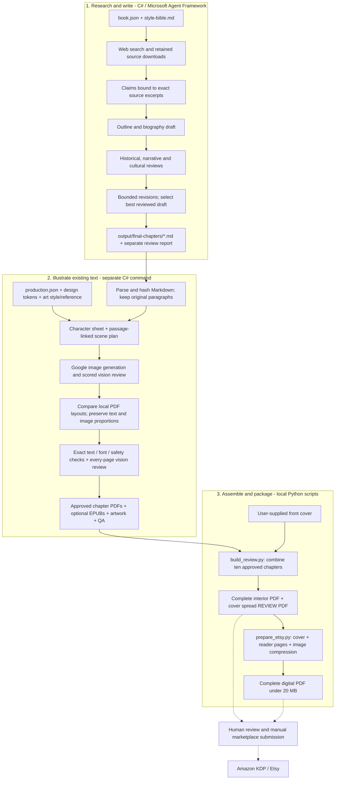
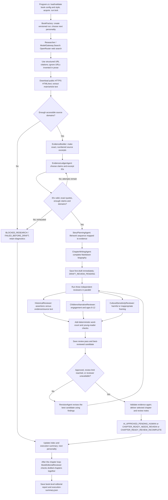
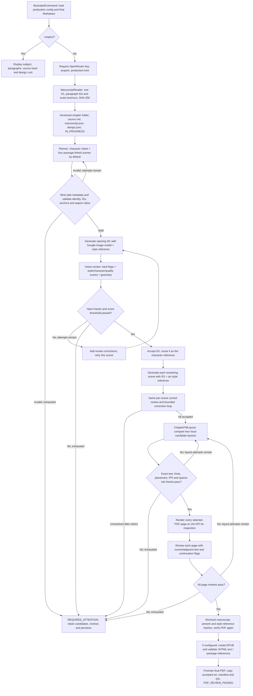
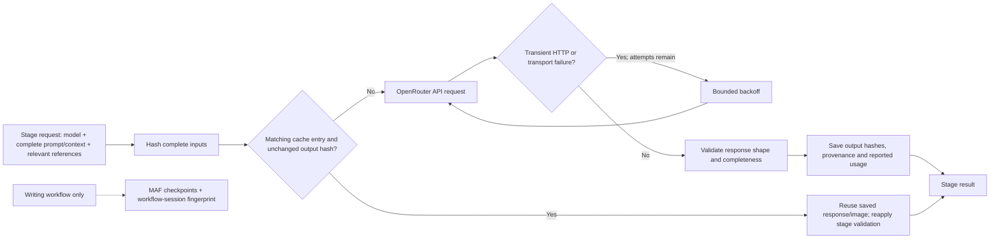
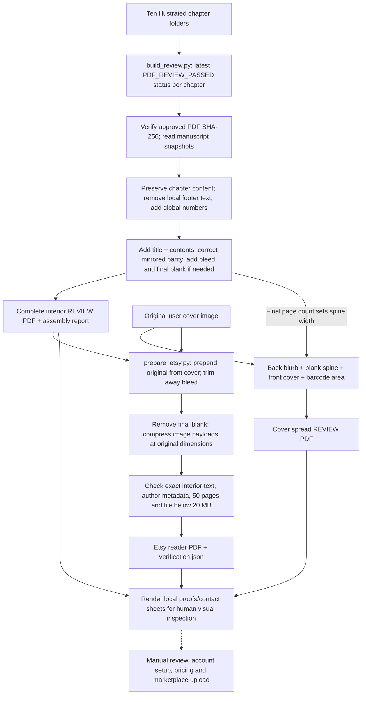

# Great Indians: the implemented publishing pipeline

The diagrams below document the original single-book workflow. Shared book definitions, topic profiles, real web photographs and configuration-driven assembly are now available; see [GENERIC_BOOKS.md](GENERIC_BOOKS.md) for the extended commands and policies. Legacy commands remain supported.

Reviewed 26 October 2026 against Git revision `73b74f0`, including the current local configuration and the publishing workspace scripts. This describes the running implementation, rather than the older requirements documents. No paid model requests or book generation were run for this review.

## 1. Full journey

The hand-off between steps 1 and 2 is a saved Markdown file. The PDF command does not run the research/writing workflow and does not rewrite the story. Whole-book assembly is a separate, local operation.



Solid arrows are implemented processing or file hand-offs. Dashed arrows are human publication activities. These programs do not upload listings, set prices, order proofs or publish to either marketplace.

## 2. Research, drafting and editorial review

Entry point: `dotnet run` from `GreatIndians.Factory`. Chapters are processed sequentially; the three editorial reviewers within a review pass run concurrently.



The `NEXT` node represents continuing the loop until all configured personalities have been attempted; only then does the book-level review run. A later technical failure also delivers the retained best draft, or the last saved draft if no reviewed candidate exists. Cancellation is propagated instead of treated as a failed chapter.

The evidence binding verifies that a quotation genuinely exists in a retained source, with its source hash and excerpt coordinates. It does **not** mathematically prove a claim is true or follows from that quotation: claim selection and historical review still involve model judgement.

### Writing policy and bounded improvement

- Current writing config: 600-900 words, British English, ages 8-12, at least 2 source domains and 8 claims, up to 6 retained sources.
- `PromptSet` and `style-bible.md` direct the biography opening, life/work sequence, simple language and evidence-only historical claims. Missing or disputed details should be omitted rather than invented.
- Critical/major findings prevent mandatory editorial approval; minor suggestions can remain.
- `ReviewPolicy.Best` prefers approved candidates, then fewer reviewer failures, fewer critical/major findings, closer word-count compliance, fewer minor findings and a later pass.
- Default maximum: 3 review passes. A review-service failure ends the chapter's revision loop and preserves the draft for review.
- `final-chapters` means final generated/delivered Markdown, not human publication approval. That distinction remains in status files and review reports.
- The book-level reviewer reports cross-chapter consistency; it does not rewrite or reassemble the chapters.
- Writing exit code `0` means every requested chapter has a draft. It does not mean every chapter is approved for publication. Missing drafts produce exit code `2`.

### Recovery command

`dotnet run -- --export-existing` uses `BookArchive.ExportExistingAsync` to inspect earlier drafts and matching review gates, select a candidate and export it without model calls. Its status is `DRAFT_RECOVERED_NEEDS_REVIEW`; it does not transfer earlier publication approval.

## 3. Illustrated chapter production

Entry point: `dotnet run -- pdf --chapter Chanakya`, or `--all`. `--inspect` parses the inputs and reports design/identity without paid calls. The illustration workflow is ordinary sequential C# orchestration, not the Microsoft Agent Framework workflow graph used for writing.



The explicit `I01` retry loop is illustrative of the shared `CreateReviewed` method: later scenes use the same logic while retaining their I01 character reference. Accepting an image ends its loop immediately. The configured scene count can be 4-7; the supplied config uses four.

### Image acceptance, exactly as implemented

```text
Overall score = round(0.40 × StyleScore + 0.30 × CharacterScore + 0.30 × QualityScore, 1)

Accept when:
  overall >= minimumImageScore (default 70; config allows 70-95)
  each category is 50-100
  all hard flags pass, issues is empty, and both comparison explanations are supplied
  image short edge >= 768 pixels
  aspect ratio is within 5% of the requested ratio
```

Hard flags: correct subject, full head, important features visible, no generated text, sound anatomy, historically plausible, matches passage, consistent character and sharp enough. Soft style-matching booleans and the model's overall `Approved` opinion are diagnostic; they do not individually veto a passing scored image. Suggestions are retained as compromises rather than treated as hard issues.

`bestScore` is only a diagnostic maximum across attempts. It does not select a fallback. If a 79-point image fails a hard check, the code still refuses it. There is no unconditional "take the best of three" mode.

### Layout and page review

The layout is generated by PDFsharp, not by an image model. Original title/paragraph text is selectable and fonts are embedded. Secondary Markdown headings are suppressed visually while retained in the source snapshot. Unsupported Markdown blocks stop processing instead of being silently removed.

- Master tokens: Liberation Serif, 12.1pt body, 17pt default leading, 22pt bold title, ivory background and the supplied colour palette.
- Candidate image scales: 1.00, 0.94, 0.88 and 0.82, with modest additional resizing when an image can fit at its narrative anchor. Text size and configured leading stay fixed.
- Selection scores page count, unused space and sparse continuation pages. A final text-only continuation of fewer than six body lines fails preflight.
- Layout attempt 1 uses base image scale 1.00; later attempts use 0.85. The current default is 2 layout attempts.
- Checks include full extracted narrative and each paragraph versus Markdown, exact font sizes/colours/weights, embedded fonts, 6 × 9-inch trim, trim safety, text/image overlap, gutter and 300+ effective image PPI.
- `PageFlowContext` supplies the previous page's last three and the next page's first three narrative lines, plus per-paragraph continuation flags. A sentence crossing pages is allowed.
- Vision review looks at actual page renders. It is instructed not to reopen accepted soft image-style compromises. Any nonpassing page review keeps the PDF from promotion.
- EPUB uses reflowable XHTML, responsive illustrations, navigation and bundled fonts. Its paragraph text and package references are checked. No complete-book EPUB assembly or EPUBCheck/Kindle device validation is implemented here.

### Approval boundary

The PDF command consumes any matching final Markdown that parses successfully. It does not look up that manuscript's historical-review status in the writing run. It preserves the text and checks illustrated production, but does not independently certify every historical claim. `PDF_REVIEW_PASSED` therefore means the illustrated chapter passed these production checks, not that marketplace publication has been approved.

## 4. Shared model, cache and recovery services



`ModelGateway` adapts OpenRouter text calls into real Microsoft Agent Framework agents. Its search route calls OpenRouter's web-search tool and retains citation metadata. `ProductionApi` uses direct structured JSON and image API requests, without MAF agents. Both use one `OPENROUTER_API_KEY`; direct provider keys and Azure are not required.

`Artifacts.Cached` first checks the current run, then earlier folders for the same chapter when input and output hashes match. Its historical `previousResearchRoots` parameter name is misleading: matching `cache/` stages beyond research can also be reused. The code retains reuse provenance. Image receipts additionally check the referenced image file hash. Layout receipts include manuscript, config, accepted images, design version and font hashes.

On a writing run, filesystem checkpoints resume only while the retained-artifact fingerprint still matches and generation is not already marked final. Otherwise the workflow re-enters and valid per-stage caches avoid repeated calls. Illustration production has no MAF checkpoints; it re-enters its sequence and uses stage caches/receipts.

Failed review responses can also be cached: an unchanged rerun may reproduce the same rejection. The CLI currently has no `--force`, `--regenerate-image` or `--retry-scene` option. Changing exact inputs invalidates the corresponding cache; manually deleting entire folders is not required for normal resume.

Logs and provenance expose model usage/cost reports but there is no enforced currency budget. Default attempt limits bound loops, not total money. One cold successful four-image chapter typically has one planning call, four image generations, four image reviews and one page review per selected PDF page; retries and structured-response/transport retries can add calls. Local PDF comparisons are not paid model calls.

## 5. Whole-book and sales packaging

These scripts live in `C:\Users\Sunil\OneDrive\Documents\ChatGPT\Great Indians Publishing Studio`, outside the Git repository. They are not invoked by `dotnet run -- pdf` and use local Python PDF libraries rather than model calls.



The scripts contain book-specific paths, names, copy and assertions. They are assembly tools for this book, not a configurable general publishing service. `build_review.py` requires exactly ten approved chapter folders, verifies their PDF hashes and compares chapter text against the saved `manuscript.json`. It does not re-run model reviews or re-read historical source pages.

The current print proof has 50 pages: title, contents, 47 chapter pages and one final blank. It uses a 6 × 9-inch trim with a 6.125 × 9.25-inch bleed media box. The reader edition has 50 pages: original front cover, title, contents and 47 chapter pages, with no final blank. Printed page labels are preserved; the front cover is unnumbered.

The cover image is user-supplied. Cover image generation/enhancement is not part of this pipeline. The current assembly report explicitly retains the low-resolution cover as a review-only limitation; the assembly script does not upscale or certify it for print. The reader script writes `Sunil Bhardwaj` into PDF metadata. The review interior/cover script still writes an empty author value; author names are not shown visually.

## 6. Current configured models and controls

These values describe this checkout, not a guarantee of provider availability or pricing.

| Work | Code path | Current model / service |
|---|---|---|
| Research search | `ModelGateway.Search` | `openai/gpt-4.1`, OpenRouter web search with Exa configured |
| Evidence selection, outline, writing and revisions | `ModelGateway.Agent` | `openai/gpt-4.1` |
| Historical, cultural and whole-book review | `ModelGateway.Agent` | `anthropic/claude-sonnet-4.5` |
| Children's narrative review | `ModelGateway.Agent` | `openai/gpt-4.1` |
| Illustration planning | `ProductionApi.JsonAsync` | `openai/gpt-4.1` |
| Artwork | `ProductionApi.GenerateAsync` | `google/gemini-3-pro-image`, configured 2K |
| Artwork and page vision review | `ProductionApi.JsonAsync` | `anthropic/claude-sonnet-4.5` |
| PDF layout / extraction / raster review images | Native C# libraries | PDFsharp / PdfPig / PDFtoImage |
| Chapter EPUB | Native C# XML/ZIP | No model call |
| Whole-book / reader assembly | Local Python scripts | pypdf / ReportLab / PDFium; no model call |

Current `book.json` lists only **Brahmagupta and Bhaskaracharya**. Running the writing command now targets those two configured personalities; it does not regenerate all ten. `production.json` uses the existing ten-subject mapping and reads the already saved Markdown chapters. This local configuration was not changed during the review.

## 7. Files responsible for each part

| Files | Responsibility |
|---|---|
| `Program.cs`, `Domain.cs`, `book.json` | Command selection, writing config/contracts, cancellation and process result |
| `BookFactory.cs` | Writing graph, chapter loop, reviewer concurrency, revision loop, checkpoints and final book editorial review |
| `Research.cs`, `EvidenceBuilder.cs` | Safe public source retrieval, exact excerpts and validated evidence bindings |
| `PromptSet.cs`, `style-bible.md`, `YoungReaderStyle.cs` | Agent instructions and deterministic young-reader prose checks |
| `ReviewPolicy.cs`, `ChapterDelivery.cs` | Mandatory checks, candidate selection, clean drafts/final chapters, review reports and archive recovery |
| `Models.cs`, `OutputContract.cs` | MAF-to-OpenRouter adapter, cited search, structured outputs, transport retries and usage |
| `Storage.cs`, `FailureDetails.cs` | Hashed stage cache, atomic saves/logging, safe failure reports |
| `Production/IllustratedCommand.cs`, `Production/ProductionDomain.cs`, `production.json` | PDF command, input selection, limits, scores and production records |
| `Production/ManuscriptReader.cs` | Authoritative Markdown parsing, subject mapping and source-change detection |
| `Production/IllustrationPlanBinding.cs`, `Production/ProductionPrompts.cs` | Passage-linked plan binding and generation/review instructions |
| `Production/IllustratedPipeline.cs` | Image sequence, character reference, acceptance/retries, layout/page gates and promotion |
| `Production/ProductionApi.cs` | Structured multimodal requests, Google image calls, receipts/cache and retries |
| `Production/ChapterPdfLayout.cs`, `Production/ProductionDesign.cs` | Deterministic layout selection, design tokens, print checks and page rendering |
| `Production/PageFlowContext.cs` | Neighbouring text and paragraph continuation markers for page reviewers |
| `Production/ChapterEpub.cs` | Reflowable chapter EPUB, embedded assets and text/package verification |
| `assets/fonts`, `assets/reference`, `illustration-style.md` | Embedded fonts, art-style example and written art direction |
| `tests/Production.RegressionTests/Program.cs` | Offline text/layout, hard/soft image-gate, sparse-page and page-flow regressions |
| Workspace `build_review.py` | Ten-chapter interior and cover review assembly |
| Workspace `prepare_etsy.py` | Full reader PDF, original cover, image compression and sales-file checks |

`PizzaAgent`, `BasicRagAgent` and `CalculateTotalRevenue` are separate applications in the same repository. Their entry points are not called by the Great Indians workflows and are not stages of this book pipeline.

## 8. Output locations and commands

Run the C# commands from `C:\Codex\great_indians_csharp\publish-repo\GreatIndians\GreatIndians.Factory`.

| Command | Result |
|---|---|
| `dotnet run` | Research/write only the personalities in `book.json` |
| `dotnet run -- --export-existing` | Recover existing Markdown drafts without API calls |
| `dotnet run -- pdf --chapter Chanakya` | Illustrate one retained chapter; PDF and configured EPUB |
| `dotnet run -- pdf --all` | Illustrate the available final manuscripts sequentially |
| `dotnet run -- pdf --all --inspect` | Read-only input/design inspection; no model calls |
| `python build_review.py` in publishing workspace | Assemble the complete print review interior/cover |
| `python prepare_etsy.py` in publishing workspace | Assemble/compress the complete digital reader PDF |

```text
GreatIndians/output/
  execution.log
  index.md
  <book-slug>-<hash>/
    current-run.json
    runs/<writing-version>/
      <number-subject>/
        research/                    source snapshots, excerpt catalogue, evidence ledger
        drafts/                      every generated writing candidate
        reviews/                     findings and gates tied to draft hashes
        revisions/                   revision provenance
        checkpoints/                 MAF workflow state
        cache/ and provenance/       requests, results, hashes and reuse records
        chapter.md, final.md         selected retained narrative
        status.json                  writing delivery/approval state
      book-review/                   book-level editorial findings
      execution-summary.json
  chapters/                          interim drafts, review reports and status sidecars
  final-chapters/                     authoritative delivered Markdown
  illustrated/
    production.log
    chapter_<number>_<subject>/<input-fingerprint>/
      source.md, manuscript.json, design.json
      illustration-plan.json, illustrations.json
      artwork/, reviews/, cache/, provenance/
      preview-<attempt>.pdf, layout-<attempt>.json, text-checks-<attempt>.json
      pages-<attempt>/, page-reviews-<attempt>.json
      chapter_<number>_<subject>_print.pdf
      chapter_<number>_<subject>.epub
      chapter_<number>_artwork/, chapter_<number>_illustrations.json
      QA.md, chapter_<number>_QA.md, status.json

Great Indians Publishing Studio/
  build_review.py, prepare_etsy.py
  output/pdf/                        full interior/cover review proofs and assembly report
  output/sales/etsy/                  complete reader PDF and verification report
  output/sales/listing-drafts.md      prepared text; not an automated publisher
  tmp/pdfs/                          rendered proofs/contact sheets for manual review
```
