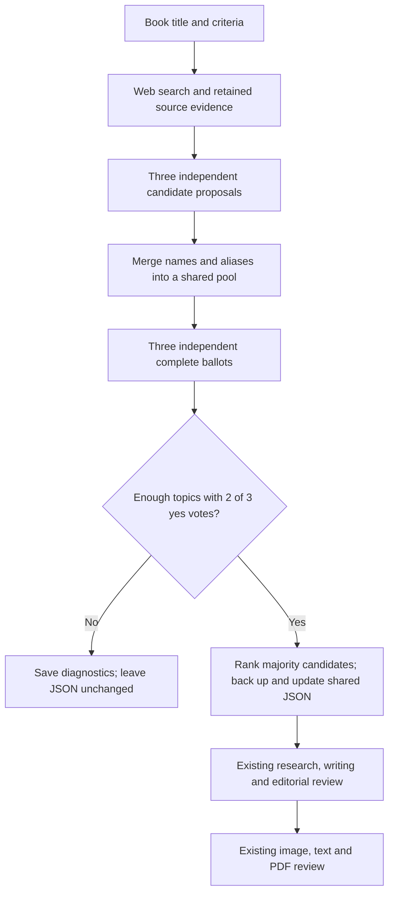

# Discover chapters with a three-model jury

Run discovery separately before writing. Give it a book title; it researches the field, asks three different AI models to propose candidates, merges names/aliases, then asks all three to vote independently on the same candidate pool. They do not see other jurors' ballots. This produces an evidence-backed editorial shortlist, not an official universal ranking.

From `GreatIndians/GreatIndians.Factory`:

```powershell
# Check paths, settings and models without network calls or file changes
dotnet run -- discover --title "Legends of Indian Science" --book ../books/indian-science.json --inspect

# Research, vote and automatically update the shared JSON
dotnet run -- discover --title "Legends of Indian Science" --book ../books/indian-science.json

# Then research/write the selected chapters; this does not generate images
dotnet run -- --book ../books/indian-science.json
```

Set `OPENROUTER_API_KEY` for a live discovery run. The assistant's regression tests make no paid calls.

Keep scope instructions separate from the printed book title. For example, to exclude ancient scientists:

```powershell
dotnet run -- discover --title "Legends of Indian Science" --book ../books/indian-science.json --prompt "Select modern Indian scientists whose main work dates from 1800 onwards. Exclude ancient and medieval figures, including Aryabhata, Brahmagupta and Bhaskaracharya. Balance different scientific fields for readers aged 8–12."
```

The prompt goes to the initial web research and every juror's nomination and ballot. Jurors must reject out-of-scope candidates rather than fill the quota with them. On a successful run it is saved as `discovery.prompt` and reused when `--prompt` is omitted. A changed prompt uses a separate cache, so previous votes cannot silently determine a different scope. Use `--prompt ""` to clear a saved prompt. The title remains unchanged. Scope instructions do not bypass evidence or majority checks.

For a new collection, a title alone is enough:

```powershell
dotnet run -- discover --title "Amazing Bridges of the World"
```

The command looks for a matching title in the nearest `books` directory. If none exists, it creates a shared JSON named from the title there. Use `--book <path>` to choose the file explicitly. For a new definition, the jurors also choose the content profile by majority; existing definitions keep their current profile unless overridden. Supported profiles are `biography`, `scientific-biography`, `temple`, `place`, `event`, and `nonfiction`.

Options:

| Option | Behaviour |
|---|---|
| `--title "..."` | Set the book title/scope; optional when an existing `--book` supplies it |
| `--book path.json` | Existing shared definition to update, or a new definition to create |
| `--prompt "..."` | Scope instructions: time period, geography, inclusions, exclusions and emphasis; saved for reruns |
| `--profile scientific-biography` | Explicit content profile; `auto` asks the jury |
| `--count 10` | Number of chapters, default 10; supported range 1–20 |
| `--inspect` | Print configuration only; no key, model calls, writes or discovery |
| `--preview` | Run paid discovery and save reports, but leave the JSON untouched |
| `--fresh` | Start a new paid session instead of using unchanged cached results |

All three jurors must return valid complete ballots. Each topic needs **at least two yes votes out of three**. Eligible topics are ordered by yes votes, then average approval rank, then stable ID; the first requested number are selected. Reject votes do not count as approval. Each juror ranks every approved candidate consecutively and cites retained source excerpt IDs. Names and aliases are consolidated before voting.

If fewer than the requested number earn a majority, a juror is unavailable, evidence cannot be retained, or no automatic profile earns a majority, the JSON stays unchanged. Inspect the retained report rather than selecting minority candidates to fill the quota. A failed juror does not reduce the denominator to two. Refining an ambiguous title, criteria or explicit profile may resolve insufficient consensus.

## Configuration and reports

The optional `discovery` object in a shared book definition controls the jury:

```json
{
  "discovery": {
    "chapterCount": 10,
    "prompt": "Modern scientists active from 1800 onwards; exclude ancient and medieval figures.",
    "jurorModels": [
      "openai/gpt-4.1",
      "anthropic/claude-sonnet-4.5",
      "google/gemini-3.1-pro-preview"
    ],
    "maxValidationAttempts": 2,
    "criteria": "Relevance, documented significance, evidence availability, engagement for ages 8–12, and balanced distinct chapters."
  }
}
```

Exactly three different OpenRouter model IDs are required. Each must support strict structured responses. Provider access and availability are verified by the user on their live run. `writing.researchModel` performs the initial bounded web search; the jury receives retained source excerpts. This is six normal jury calls (three nominations plus three ballots), plus research. Invalid responses have bounded retries; unchanged successful stages are cached. There is no automatic repeated voting until agreement, and no guarantee of a fixed dollar cost.

The console prints the full report directory:

```text
<outputRoot>/<book-id>/discovery/<input-fingerprint>/
  status.json
  research/discovery-excerpts.json
  proposals/juror-1.json ... juror-3.json
  candidate-pool.json
  ballots/juror-1.json ... juror-3.json
  selection.json
  selection-report.md
  config-backups/<original-config-hash>.json
  cache/ and provenance/
```

`discovery.log` sits in the parent discovery directory. The complete selection JSON retains accepted and rejected candidates, reasons, votes and models. The Markdown report is the readable summary. On a provider failure, completed jurors and research are reused on an unchanged rerun. `--fresh` deliberately purchases a different session; a failed fresh run retains its files but another `--fresh` starts another session.

Only a successful complete selection changes the book definition. It preserves unrelated settings (including cover/blurb, models and image policy), retains curated subject IDs/photo settings where matched, saves a previous-config backup and checks for edits made while discovery was running. It never writes chapters or modifies existing manuscripts.

Discovered books include `requireDiscoveryApproval` and a selection certificate bound to title, profile and ordered subject names/IDs. Normal text/PDF commands validate that certificate; rerun discovery after changing the chapter list. This is a local consistency check, not a tamper-proof signature. Existing manually configured books remain compatible.

When the ordered chapter list changes, `selectionId` sends subsequent writing, illustration and book assembly to `<outputRoot>/<book-id>/selections/<selection-id>/`. Previous book output remains available. If the list is unchanged, the existing output location is retained.

Discovery approval applies only to **chapter selection**. Each selected subject still undergoes its own research, evidence validation, historical/scientific, narrative and cultural review. Illustration and PDF checks remain mandatory. The jury does not rewrite the story or weaken those later gates.


